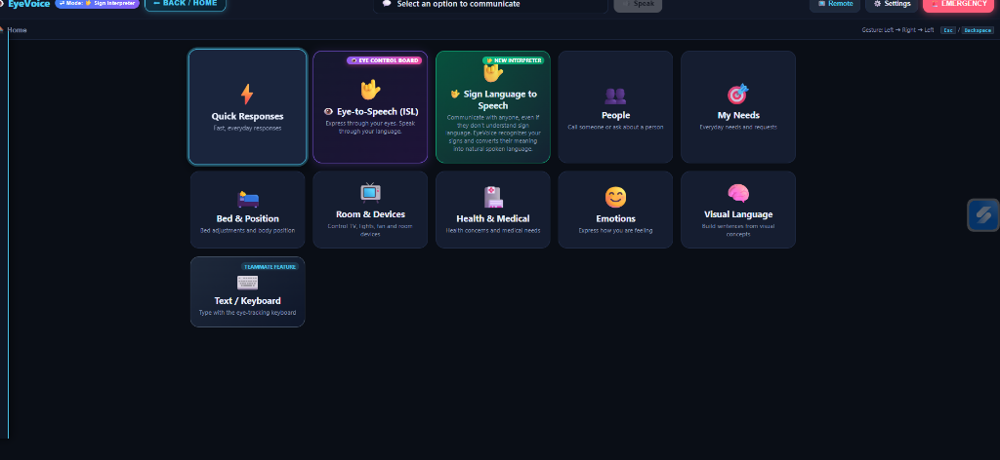
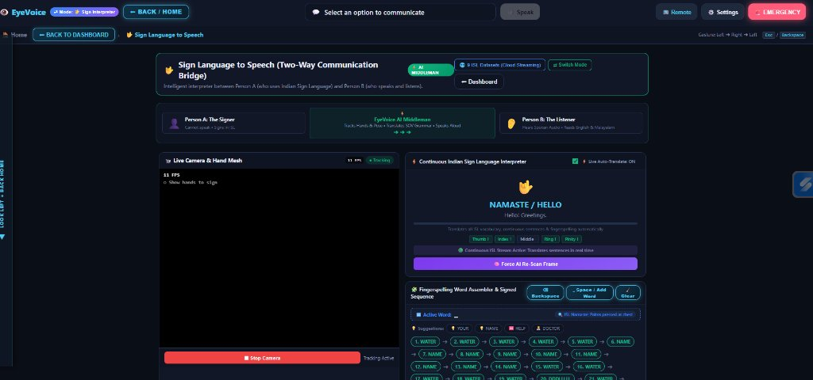

# SHN-MEDIAPIPE

# 🚀 EyeVoice — Real-Time Eye-Gaze & Indian Sign Language Communication System

### 💡 What's the idea?
EyeVoice is an AI-powered multimodal assistive communication system designed for non-verbal individuals, ALS/stroke patients, and the Deaf/Hard-of-Hearing community. It provides two live pathways:
1. Hands-free Eye-Gaze-to-Speech communication using standard webcams with real-time iris tracking and deliberate dwell selection.
2. Continuous Indian Sign Language (ISL) recognition & fingerspelling that translates natural signing into spoken English and Malayalam speech.

### 🌐 Check it out!
- **Live Website:** https://eyevoice.onrender.com/
- **GitHub Repo:** https://github.com/mrmalayali555/SHN-MEDIAPIPE

### 🛠️ What did you use?
- **AI & Computer Vision:** Google MediaPipe (FaceLandmarker & Hand Landmarker), Google Gemini Multimodal Vision API (continuous gesture sequence interpretation)
- **Signal Processing & Interaction:** OneEuro Gaze Stabilization Filter, Velocity-Valley Sign Segmentation, ISL Non-Manual Marker (NMM) facial analysis
- **Backend:** Python 3.12, Flask, Server-Sent Events (SSE)
- **Frontend:** HTML5, CSS3, JavaScript (ES6+ WebGL), Web Speech API (TTS)
- **Datasets & Research:** Hugging Face Datasets, ISL-CSLTR, iSign, ISLVT, CISLR

### 👥 The Humans Behind It
- Jaisingh – [@mrmalayali555](https://github.com/mrmalayali555)
- Nikhildath – [@Nikhildath](https://github.com/Nikhildath)

### ⚙️ Hardware Corner
- Standard RGB Laptop Webcam or USB Camera (30/60 FPS). Zero proprietary eye-trackers, infrared sensors, or sensory gloves required.

### 📸 Show Us What You Built!

*EyeVoice Patient AAC Dashboard with Quick Responses, ISL Board, and Caregiver Controls*

*Real-Time Continuous Indian Sign Language (ISL) Interpreter and Fingerspelling Word Assembler*

### ✨ Cool Things It Does
- **Accessible Eye-Tracking AAC:** 1-second quick center calibration, anti-jitter OneEuro filtering, and deliberate dwell selection without accidental touches.
- **Continuous Indian Sign Language Recognition:** Recognizes 72+ conversational ISL tokens and 26 A-Z fingerspelling letters with velocity-valley stroke segmentation.
- **Linguistic Grammar Translation:** Converts ISL Topic-Comment / SOV sign structures into grammatically correct English and Malayalam spoken sentences.
- **Non-Manual Marker (NMM) Detection:** Reads facial expressions (eyebrow furrowing for WH-questions, eyebrow elevation for Yes/No questions).
- **Two-Way Caregiver Communication:** Immediate speech playback, caregiver messaging board, emergency alerts, and remote device control.

---

**Built with curiosity at Saturday Hack Night 💜**
